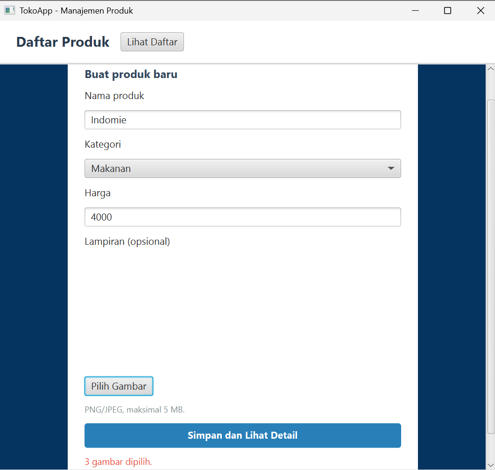
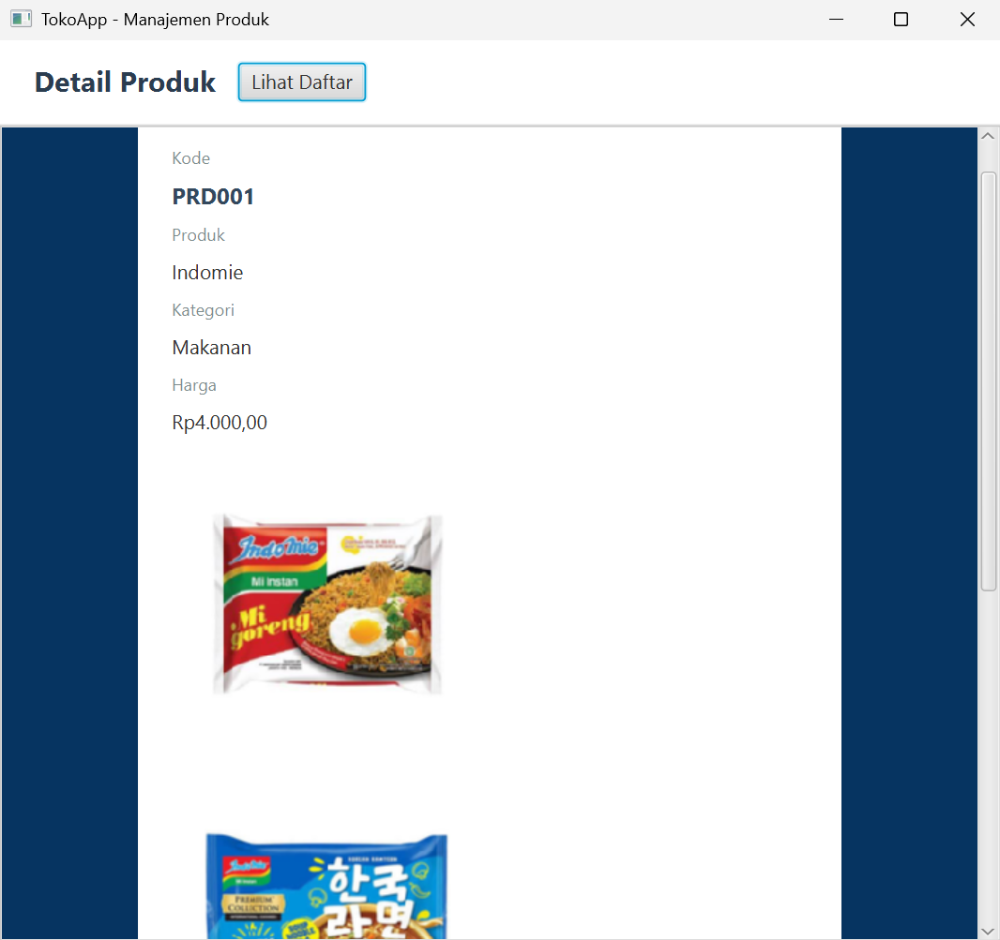
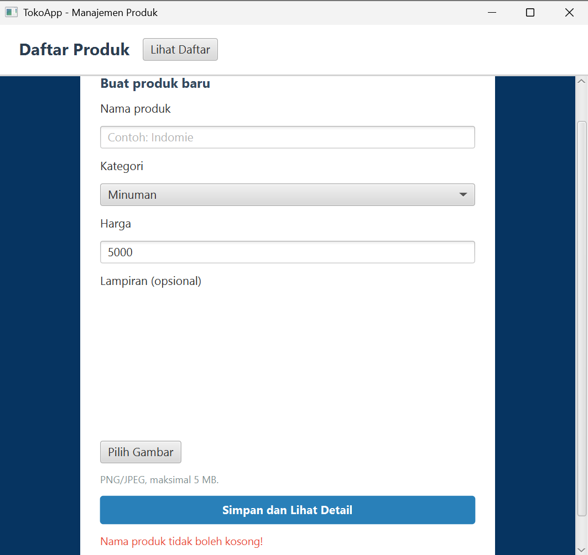
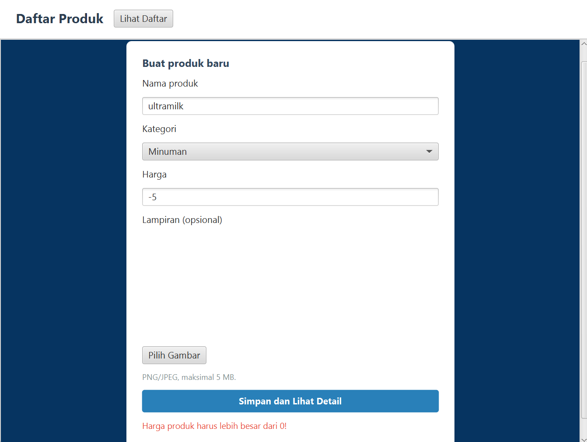
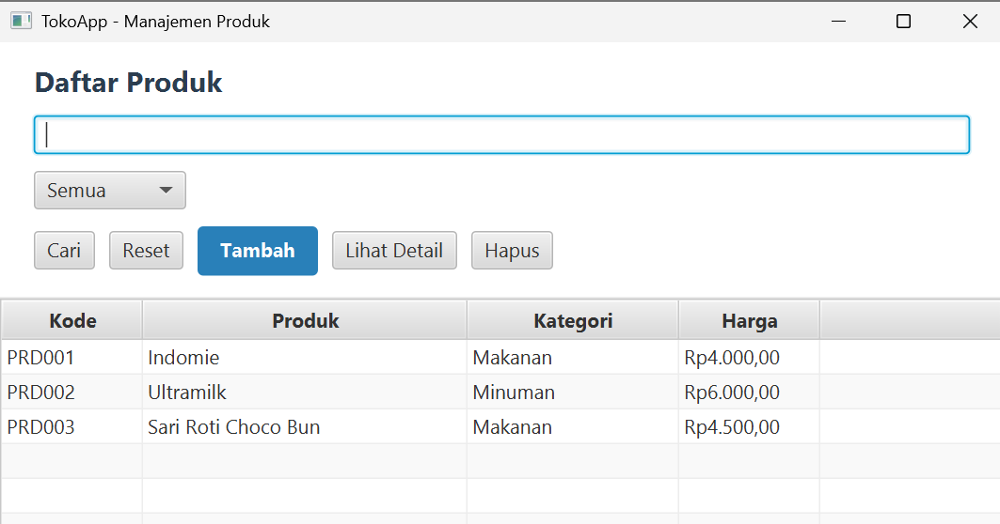
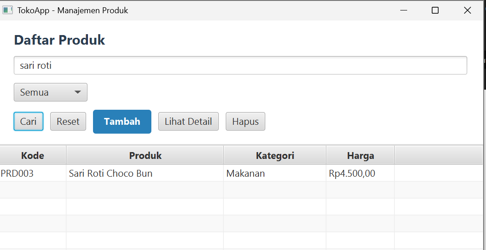

# TokoApp - Aplikasi Manajemen & Pencatatan Produk Toko

TokoApp adalah aplikasi desktop berbasis JavaFX dan Maven yang dikembangkan untuk membantu mencatat dan mengelola data produk toko secara lokal. Aplikasi ini dilengkapi dengan form input untuk memasukkan data produk baru (seperti kode, nama, kategori Makanan/Minuman, dan harga), tabel data utama, fitur pencarian produk berdasarkan nama, serta halaman detail yang menampilkan informasi lengkap dan galeri gambar produk secara dinamis.

---

## 📋 Fitur Utama
1. **Form Tambah Produk**: Memungkinkan pengisian nama, kategori (Makanan/Minuman), dan harga produk.
2. **Validasi Input**:
   - Nama produk tidak boleh kosong.
   - Harga produk harus lebih besar dari `0`.
3. **Tabel Data Produk**: Menampilkan daftar produk secara lengkap (Kode, Nama, Kategori, dan Format Harga Rp).
4. **Pencarian Produk**: Mencari produk berdasarkan kata kunci nama produk menggunakan tombol **Cari**.
5. **Halaman Detail Produk**: Menampilkan rincian data produk beserta lampiran gambar yang dimuat secara dinamis dari objek produk yang dipilih.

---

## 🚀 Cara Menjalankan Aplikasi
### 1. Clone Repository

Buka terminal atau Command Prompt, kemudian jalankan perintah berikut:

```bash
git clone https://github.com/lannmhrni/Manajemen-Produk.git
```

### 2. Masuk ke Direktori Project

Setelah proses clone selesai, arahkan terminal ke folder proyek:

```bash
cd Toko
```

### 3. Periksa Instalasi Java dan Maven

Pastikan JDK dan Maven sudah terpasang dengan menjalankan perintah:

```bash
java -version
```

```bash
mvn -version
```

### 4. Buka Project
Buka Apache NetBeans, kemudian pilih **File → Open Project**. Cari folder `Toko` yang sudah di-clone sebelumnya.

### 5. Jalankan Aplikasi

Buka terminal pada direktori utama proyek, kemudian jalankan perintah:

```bash
mvn clean javafx:run
```

Tunggu hingga proses build selesai. Jika berhasil, aplikasi Kalkulator BMI akan terbuka dan siap digunakan.

---

## 📸 Tampilan Aplikasi

Berikut adalah dokumentasi tampilan antarmuka serta pengujian aplikasi sesuai ketentuan tugas:

### 1. Form Input Produk & Lampiran Gambar


### 2. Tampilan Detail Produk


### 3. Validasi: Nama Produk Kosong


### 4. Validasi: Harga Tidak Valid (≤ 0)


### 5. Tabel Daftar Produk


### 6. Fitur Pencarian Produk

